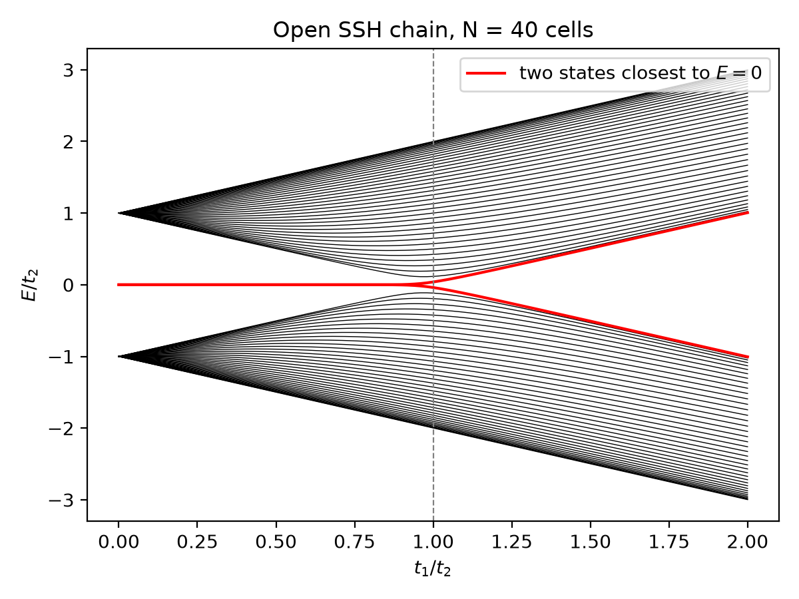
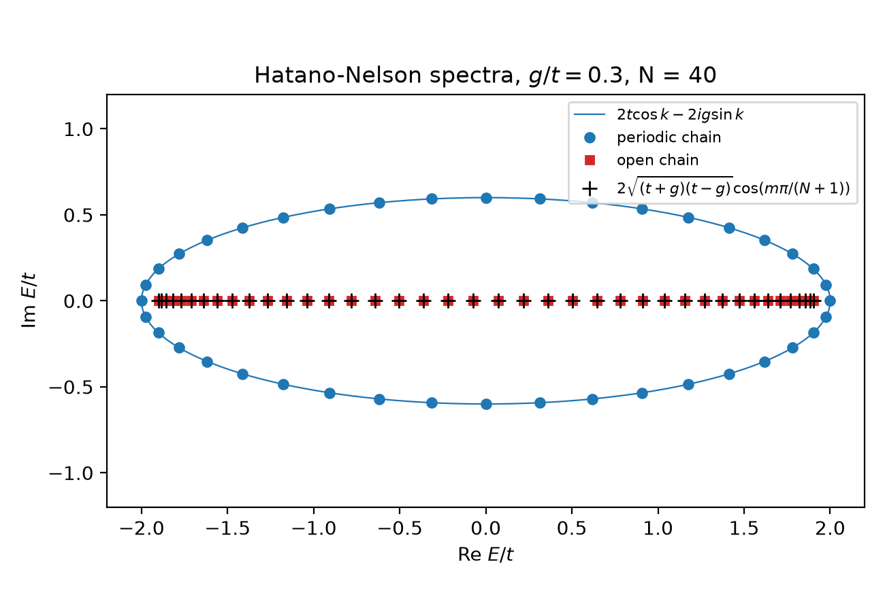
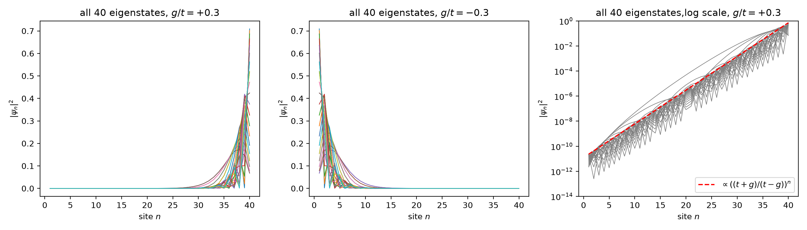
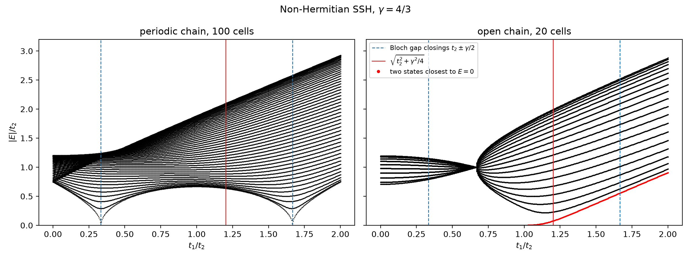

## References

- J. K. Asbóth, L. Oroszlány, A. Pályi, *A Short Course on Topological Insulators*,
  Lecture Notes in Physics 919, Springer (2016), arXiv:1509.02295.
- N. Hatano and D. R. Nelson, Localization transitions in non-Hermitian quantum mechanics,
  Phys. Rev. Lett. 77, 570 (1996).
- S. Yao and Z. Wang, Edge states and topological invariants of non-Hermitian systems,
  Phys. Rev. Lett. 121, 086803 (2018).
- F. K. Kunst, E. Edvardsson, J. C. Budich, E. J. Bergholtz, Biorthogonal bulk-boundary
  correspondence in non-Hermitian systems, Phys. Rev. Lett. 121, 026808 (2018).
- E. J. Bergholtz, J. C. Budich, F. K. Kunst, Exceptional topology of non-Hermitian systems,
  Rev. Mod. Phys. 93, 015005 (2021).
