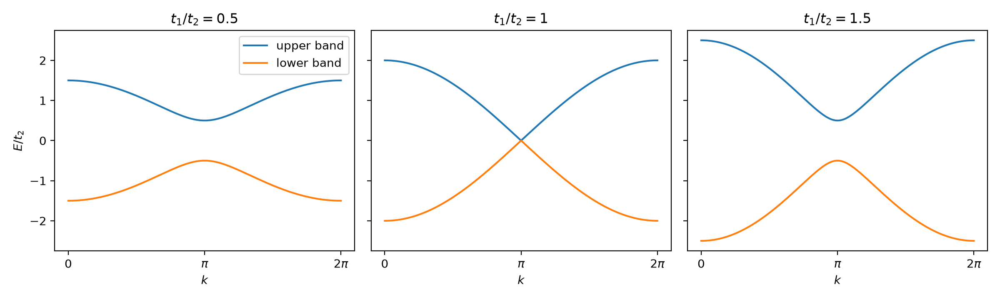
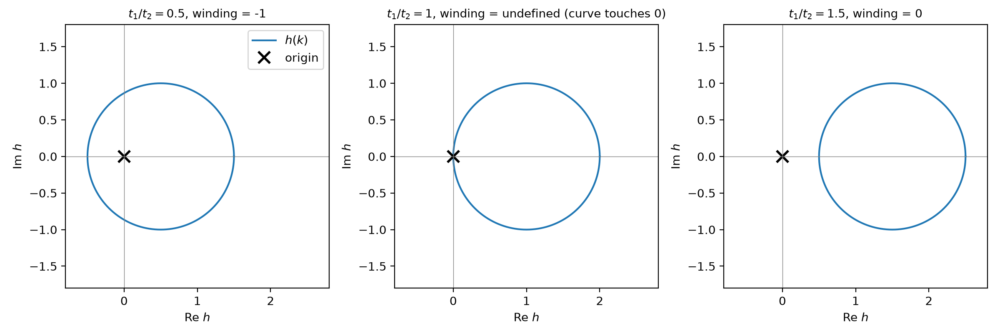
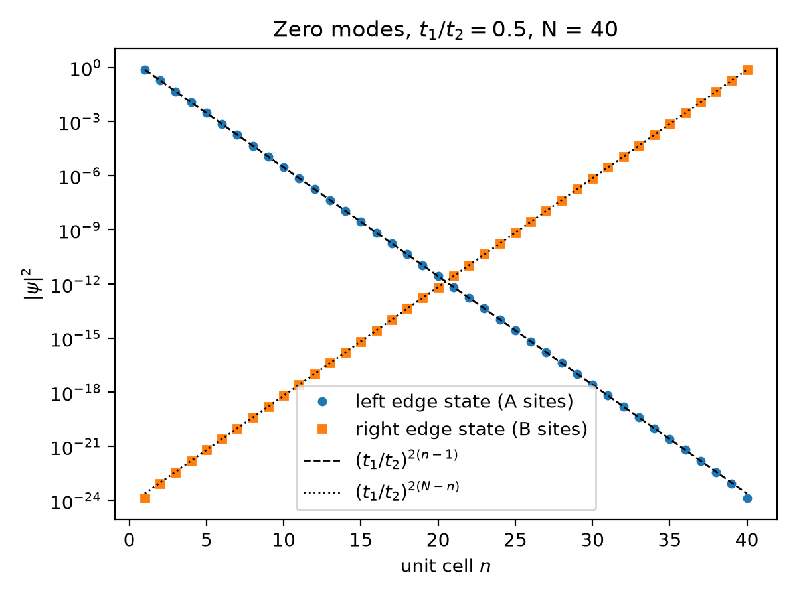
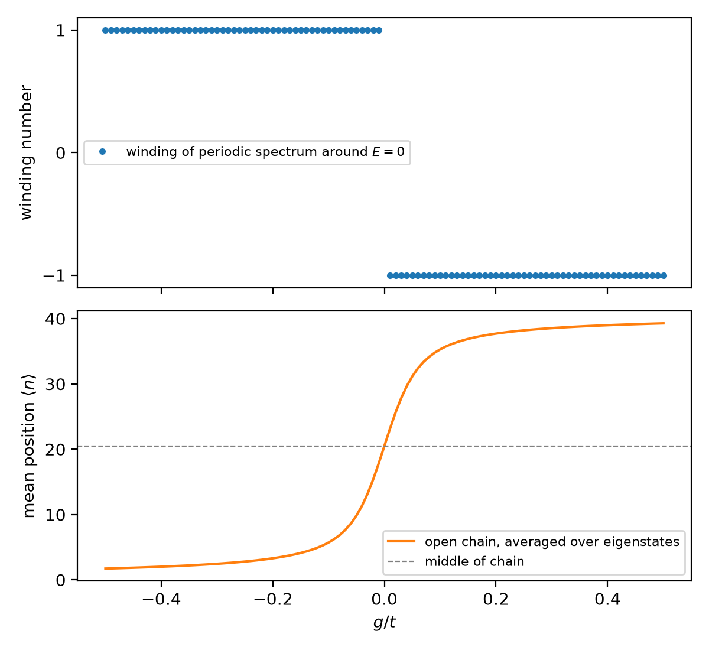
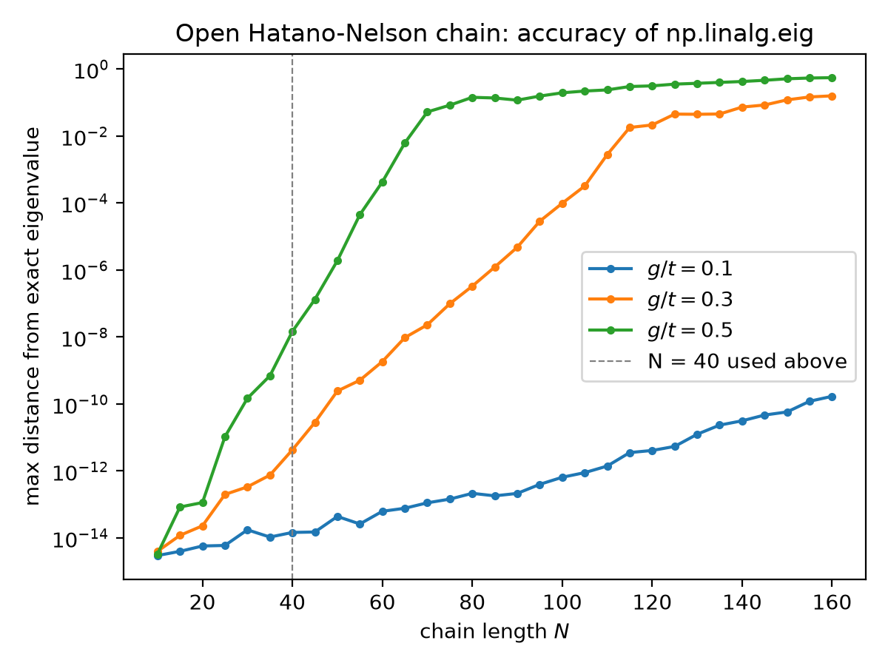
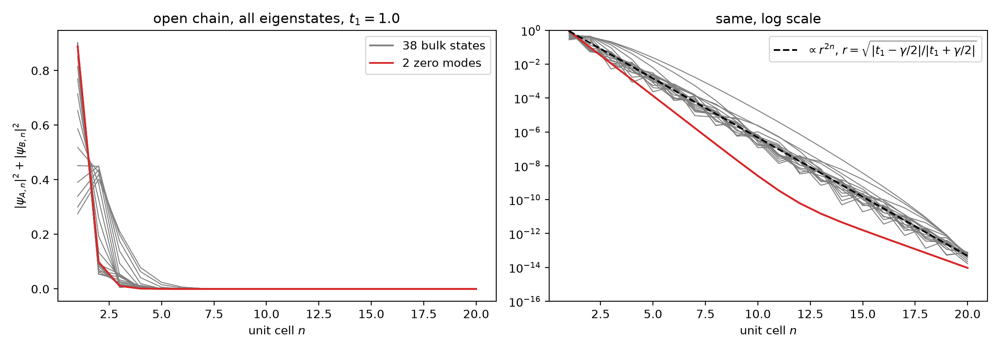
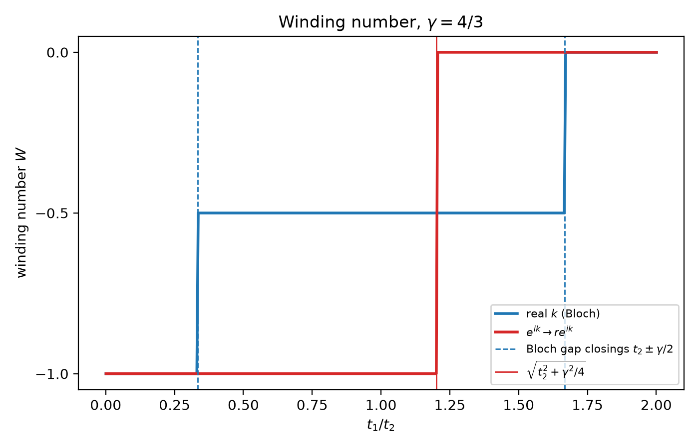

# Edge states and the non-Hermitian skin effect in 1D chains

This repo is my own work through the basic models of 1D topological and non-Hermitian
tight-binding chains. I start with the Su-Schrieffer-Heeger (SSH) chain, where a winding number
predicts edge states, and then move on to non-Hermitian chains, where the usual link between
bulk and edge breaks down. Each part is one short Python script that builds the Hamiltonian
matrix, diagonalises it, and checks the numerics against the analytic results.

> **TODO (me): a paragraph on why I did this.**

## Part 1: SSH chain

The chain has two sites per unit cell, A and B, with hopping $t_1$ inside a cell and $t_2$
between cells. In momentum space the off-diagonal element of the 2x2 Bloch Hamiltonian is

$$h(k) = t_1 + t_2 e^{-ik}, \qquad E(k) = \pm |h(k)|.$$



The gap closes at $k = \pi$ only when $t_1 = t_2$. The two gapped phases look the same
in the bands, but the curve $h(k)$ tells them apart: for $t_1 < t_2$ it encircles the origin,
for $t_1 > t_2$ it does not.



I compute the winding number by unwrapping the phase of $h(k)$ around the Brillouin zone. I get
$-1$ for $t_1 < t_2$ and $0$ for $t_1 > t_2$. The sign is a convention: it comes from
$e^{-ik}$ running clockwise, and tracking the other off-diagonal element $h^*(k)$ gives $+1$, as in Asbóth et al.


In an open chain of 40 cells, two states sit at $E = 0$ throughout $t_1 < t_2$ and merge into
the bulk bands for $t_1 > t_2$, as the winding number predicts.



The two near-zero eigenstates are the even and odd combinations of one state on each edge.
Because of chiral symmetry, the left state lives only on A sites and the right state only on
B sites, so I separate them by taking the A and B parts. The amplitude falls by exactly
$t_1/t_2$ per cell, which the script checks with an assert. The edge states overlap slightly,
and that splits their energies to $\pm(t_2 - t_1^2/t_2)(t_1/t_2)^N$, which is $6.8 \times 10^{-13}$
here. The script checks this against the numerical value too.

## Part 2: Hatano-Nelson chain

This chain has one site per cell, with hopping $t+g$ to the right and $t-g$ to the left, so for
$g \neq 0$ the Hamiltonian is not Hermitian. I use $t = 1$, $g = 0.3$ and $N = 40$ sites.


With periodic boundaries the eigenvalues lie on the ellipse $E(k) = 2t\cos k - 2ig\sin k$.
With open boundaries they are all real and lie on a line inside it, at
$2\sqrt{(t+g)(t-g)}\cos(m\pi/(N+1))$. The script checks both against the numerics (errors of
$10^{-15}$ and $10^{-12}$). So, unlike in a Hermitian chain, cutting a single bond changes the
whole spectrum and not just a few edge states.


Every eigenstate of the open chain sits at the right end for $g > 0$ and at the left end for
$g < 0$. This is the non-Hermitian skin effect. The reason is that
$H = S H_{\rm sym} S^{-1}$ with $S = {\rm diag}(r^n)$ and $r = \sqrt{(t+g)/(t-g)}$, where $H_{\rm sym}$
is a Hermitian chain with hopping $\sqrt{(t+g)(t-g)}$. So every eigenstate is a standing wave
times $r^n$, and $|\psi_n|^2$ grows by $(t+g)/(t-g)$ per site. The fitted slope of the envelope
on the log plot is 0.6190 and the prediction is $\ln(1.3/0.7) = 0.6190$.



The periodic spectrum winds once around $E = 0$ for any $g \neq 0$: clockwise ($-1$) for
$g > 0$ and anticlockwise ($+1$) for $g < 0$. The sign of the winding tells you which end the states
pile up at. At $g = 0$ the ellipse collapses onto the real axis, there is no winding and no skin
effect, and the eigenstates are ordinary standing waves centred on the middle of the chain.



The open Hatano-Nelson matrix is very non-normal, so `np.linalg.eig` loses accuracy as $N$
grows. The error grows roughly like $r^N$, which is the condition number of $S$. At $g = 0.5$ it
reaches $10^{-1}$ by $N \approx 80$. I use $N = 40$, where the error is $10^{-11}$ at $g = 0.3$.

## Part 3: non-Hermitian SSH chain

This is the SSH chain from Part 1 with the intracell hopping made asymmetric: $t_1 + \gamma/2$
one way and $t_1 - \gamma/2$ the other. Following Yao and Wang I use $t_2 = 1$, $\gamma = 4/3$, so

$$H(k) = (t_1 + t_2\cos k)\,\sigma_x + (t_2 \sin k + i\gamma/2)\,\sigma_y.$$


The periodic spectrum closes its gap at $t_1 = t_2 \pm \gamma/2$ (1/3 and 5/3). In the open chain
nothing happens at those points. Instead the zero modes join the bulk near
$t_1 = \sqrt{t_2^2 + \gamma^2/4} = 1.202$. So the Bloch Hamiltonian no longer predicts where
the edge states are. With 20 cells the zero modes are split by about $(t_1'/t_2)^N$
(with $t_1'$ defined below), so they lift off gradually from about $t_1 = 1$ rather than sharply at 1.202.



At $t_1 = 1$ every eigenstate of the open chain sits at the left edge, including the two zero
modes. The bulk states decay as $r^{2n}$ per cell with $r = \sqrt{|(t_1 - \gamma/2)/(t_1 + \gamma/2)|}$.

The reason is the same as in Part 2. Rescaling each cell by $r$ turns the open chain into a
Hermitian SSH chain with intracell hopping $t_1' = \sqrt{(t_1 - \gamma/2)(t_1 + \gamma/2)}$. I checked
numerically that the two spectra agree to $10^{-14}$ for $t_1 > \gamma/2$, where $t_1'$ is real. From
Part 1, that Hermitian chain has zero modes when $t_1' < t_2$, which is exactly
$t_1 < \sqrt{t_2^2 + \gamma^2/4}$.



The fix is to compute the winding number with $e^{ik}$ replaced by $re^{ik}$, so the
eigenstates' exponential profile is built into the momentum. I take
$W = [w(h_+) - w(h_-)]/2$, where $h_\pm$ are the two off-diagonal elements of $H(k)$, and this
reduces to the Part 1 winding when $\gamma = 0$. On the real Brillouin zone $W$ takes the
non-integer value $-1/2$ between the two Bloch gap closings and says nothing useful there. With complex $k$, $W$ is an integer
and jumps from $-1$ to $0$ at $t_1 = 1.206$ on my grid (step 0.005), matching 1.2019.

Kunst et al. reach the same transition by a different route, using the left and right
eigenvectors of $H$ together (a biorthogonal bulk-boundary correspondence). I haven't reproduced
that here.

## Things I noticed

- The near-zero modes that `eigh` returns are not localised on one edge. Each one is a mixture
  of both edges. I needed the sublattice structure to separate them.
- When `eig` fails on the long Hatano-Nelson chain, it doesn't fail quietly with small random
  errors. The eigenvalues move off the real axis into the complex plane, towards the periodic
  ellipse, even though the exact spectrum is real.
- In the Hatano-Nelson chain all $N$ states are localised, so "edge state" stops being a
  useful idea there.
- At $t_1 = 1$ both zero modes of the non-Hermitian SSH chain sit at the left edge, not one at
  each end as in Part 1. The right-edge mode grows towards the right by $t_2/t_1'$ per cell, but
  the skin factor $r$ multiplies this down to $t_2/(t_1 + \gamma/2)$. So it moves to the left edge
  for $t_1 > t_2 - \gamma/2 = 1/3$, which happens to be a Bloch gap closing. I checked that it is
  still on the right at $t_1 = 0.1$ and $0.2$.
- The open non-Hermitian SSH matrix is even more non-normal than Hatano-Nelson near
  $t_1 = \gamma/2$, where one hopping vanishes. `eig` is accurate to $10^{-13}$ at 20 cells
  but only $10^{-5}$ at 40 cells, so I used 20.

## What I don't understand yet / what I'd do next

> **TODO (me).**

## How to run it

```
pip install -r requirements.txt
python 01_ssh.py
python 02_hatano_nelson.py
python 03_nh_ssh.py
```

Each script prints its checks against the analytic results and saves its figures to `figures/`.

## References

- J. K. Asbóth, L. Oroszlány, A. Pályi, *A Short Course on Topological Insulators*,
  Lecture Notes in Physics 919, Springer (2016), arXiv:1509.02295.
- N. Hatano and D. R. Nelson, Localization transitions in non-Hermitian quantum mechanics,
  Phys. Rev. Lett. 77, 570 (1996).
- S. Yao and Z. Wang, Edge states and topological invariants of non-Hermitian systems,
  Phys. Rev. Lett. 121, 086803 (2018).
- F. K. Kunst, E. Edvardsson, J. C. Budich, E. J. Bergholtz, Biorthogonal bulk-boundary
  correspondence in non-Hermitian systems, Phys. Rev. Lett. 121, 026808 (2018).
- E. J. Bergholtz, J. C. Budich, F. K. Kunst, Exceptional topology of non-Hermitian systems,
  Rev. Mod. Phys. 93, 015005 (2021).
